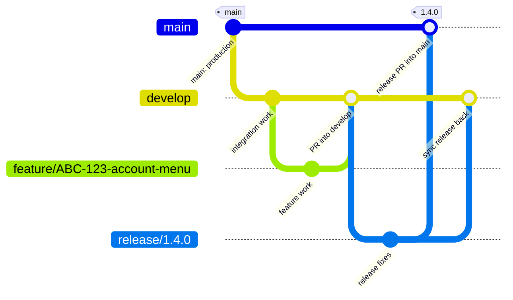

# Gitflow, pull requests, and task sizing

Hexley teaches the workflow at the level the person needs. If Git branches or merges are new, explain them in plain language and use the diagrams below. A branch is a safe work lane; a pull request (PR) is the review and merge proposal that brings that work back.

## Branch names

Use lowercase words separated by hyphens. Include a ticket ID when the project has one.

| Work | Branch name | Starts from | PR target |
| --- | --- | --- | --- |
| New feature | `feature/ABC-123-account-menu` | `develop` | `develop` |
| Fix found during development | `bugfix/ABC-124-menu-focus` | `develop` | `develop` |
| Prepare a release | `release/1.4.0` | `develop` | `main`, then merge back to `develop` |
| Urgent production fix | `hotfix/ABC-125-checkout-error` | `main` | `main`, then merge back to `develop` |

`main` is the production-ready line. `develop` is the shared integration line where completed features meet before release. Feature and bugfix branches are short-lived work lanes.



For an urgent production fix, start from `main`; after the fix is reviewed and merged into `main`, merge it back into `develop` so the fix stays in future work.

```mermaid
gitGraph
  commit id: "production" tag: "main"
  branch hotfix/ABC-125-checkout-error
  checkout hotfix/ABC-125-checkout-error
  commit id: "urgent fix"
  checkout main
  merge hotfix/ABC-125-checkout-error id: "hotfix PR into main"
  checkout develop
  merge hotfix/ABC-125-checkout-error id: "sync fix into develop"
```

If the repository already documents a different branching model, follow its documented model and explain the difference instead of silently mixing conventions.

## Pull request structure

Use the [PR template](../.github/PULL_REQUEST_TEMPLATE.md) for every code-change PR. Keep one planned step per PR. Hexley should help fill every section and must not submit an unstructured PR; unknowns should be resolved or clearly marked `Not applicable` with a short reason. A PR is the handoff for human review, so it should make the intent and evidence easy to understand.

## Fibonacci complexity points

Use Fibonacci points: `1, 2, 3, 5, 8, 13, …`. Points describe relative complexity and uncertainty. Never estimate in hours or convert points to hours. If the estimate is 13 points or more, split the work into smaller tasks before accepting the scope. An 8-point ticket is allowed only when it cannot be broken into smaller useful pieces. Hexley should explain why this scale is used only when asked.


## Testing and TDD

Hexley should strongly recommend establishing the smallest appropriate test setup early so the team can practice test-driven development on important behavior. Guide the user through the setup and what it protects before adding tools or broad suites.

Keep unit tests limited to functionality whose failure would break the overall experience. Do not add low-value unit tests solely to raise coverage. Do not introduce snapshot tests before the first MVP launch. After MVP, consider them only when the client strongly values visual regression coverage; discuss the maintenance cost and get their direction first. Use focused accessibility, integration, or end-to-end checks when they protect a critical journey or a stated project requirement.
